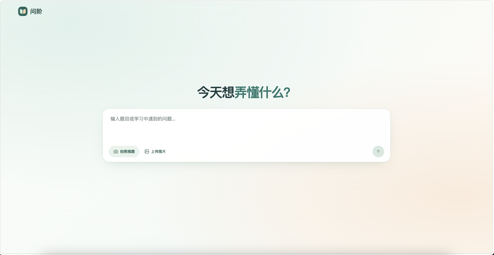
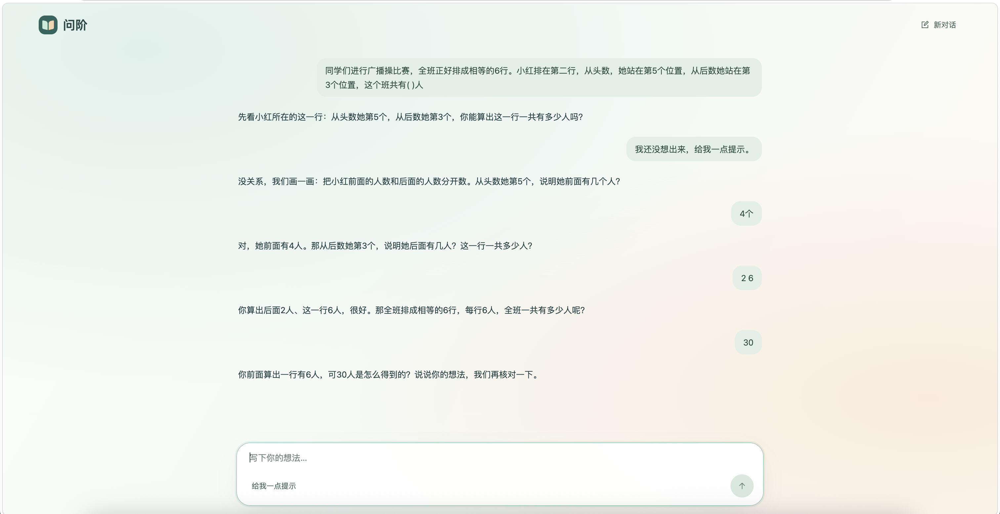

# 问阶 · 引导式 AI 搜题工具

问阶是一款面向中小学生的多学科 AI 搜题工具。遇到不会的题，你可以拍照、上传题图或直接输入题目。**搜题后，问阶不会直接给出答案。** 它会从一个小问题开始，等你回答，再根据你的思路给出下一步提示，直到你自己解出这道题。

比如，你拍下一道排队题。问阶先问「小红从前往后数排第 5，她前面有几个人？」你回答「4 个」后，它再引导你数小红后面的人。如果你连第一步也没想出来，可以点「给我一点提示」，从画出这一排的位置开始。



## 怎么用

1. **把题目发过来。** 可以直接打字，也可以拍照或上传已有的题图。支持 6 MB 以内的 JPG、PNG 和 WebP。使用图片时，先核对识别出的题面，尤其是公式、单位和选项，再发送。
2. **写下你想到的一步。** 哪怕只找到一个条件，也可以直接回复。做阅读题时，导师会引导你回原文找依据；做数学题时，可以先从题里的数量关系入手。
3. **按自己的节奏继续。** 卡住时点「给我一点提示」，有想法就接着写。按 Enter 发送，按 Shift+Enter 换行。



图中也有一个值得自己核对的地方：前面 4 人、后面 2 人，加上小红本人，每行应有 7 人。导师在这轮对话中漏算了小红。遇到类似情况，可以把你的算式发回去，请它重新核对。

## 先在本机试一道题

下载项目后，用浏览器打开 `index.html`，输入 `3x + 5 = 20` 就能开始。这个离线模式内置了小学到高中的数学练习和一类一元一次方程，无需模型密钥。想带自己的新题来问，或练习语文、英语等学科，请启动下方的模型服务。

### 连接模型，练习自己的题目

准备 Node.js 22.9 或更高版本，以及一个兼容 Chat Completions 接口的模型账号。在项目目录运行：

```sh
npm ci
npm run build
```

在项目根目录创建 `.env.deepseek`。下面以 DeepSeek 文本对话为例，把模型 ID 和密钥换成你账号可用的值：

```dotenv
MODEL_URL=https://api.deepseek.com/chat/completions
MODEL_NAME=你的模型ID
MODEL_KEY=你的服务端密钥
```

```sh
node --env-file=.env.deepseek server.mjs
```

在浏览器打开 [本机问阶](http://127.0.0.1:4173)。输入题目即可开始多轮对话。**拍照和上传题图需要支持图片输入的模型**。使用视觉模型时，将上述三个配置项改为该服务的接口地址、模型 ID 和密钥。服务端会将题面、相关对话和随题附带的图片发送给所配置的模型服务商。

### 可选：在 macOS 本机识别题图

离线练习也可以使用 Apple Vision 读取图片。安装 Xcode 命令行工具后，在已执行 `npm ci` 的项目目录运行：

```sh
swiftc ocr.swift -o ocr
npm start
```

打开同一个本机地址，上传图片并核对题面。未配置模型时，引导范围与内置离线练习相同。

### 可选：保存对话到 MySQL

需要留存学习记录时，在本机 MySQL 8 中执行 [schema.sql](schema.sql)，给应用账号授予 `wenjie.learning_turns` 表的 `INSERT` 和 `SELECT` 权限。在项目根目录创建 `.env.mysql`，填写以下配置并重启 Node 服务：

```dotenv
WENJIE_DB_USER=你的应用账号
WENJIE_DB_PASSWORD=你的数据库密码
WENJIE_DB_PORT=3306
```

每个对话轮次保存题面、学生输入、导师回复和完成状态。用 `conversation_id` 找到同一段对话，按 `turn_number` 排序即可回看。表中只保存文字，原始题图不入库。
